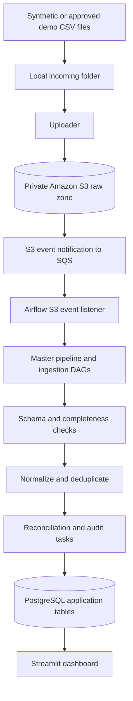

# E-Commerce Revenue Assurance & Refund Reconciliation Platform

A local-first data engineering portfolio project for checking whether e-commerce orders, payments, provider settlements, shipments, returns, and refunds agree. The pipeline orchestrates ingestion and reconciliation with Apache Airflow, stores operational results in PostgreSQL, can use Amazon S3/SQS for file landing and event notifications, and presents results through a Streamlit dashboard.


## Goals

- Ingest dated source files and validate their schemas and required fields.
- Track source completeness and make missing or late feeds visible.
- Reconcile orders against payments, provider settlements, shipments, returns, and refunds.
- Create traceable exceptions for unmatched records, amount differences, overdue refunds, and delivery SLA breaches.
- Support safe reruns, duplicate handling, audit history, and operational recovery.
- Show reconciliation results and open exceptions in a local dashboard.

## Architecture



S3/SQS integration is optional for local-only development. Airflow is an orchestrator; scheduled S3 polling and queue processing are micro-batch workflows, not sub-second streaming.

## Technology stack

- Windows with Docker Desktop and WSL 2
- Docker Compose
- Apache Airflow
- PostgreSQL
- Python and SQL
- Streamlit
- Amazon S3 and SQS for the optional AWS-backed landing-zone workflow

## Repository layout

The exact files in the repository depend on which components are staged for publication. A typical layout is:

```text
.
├── dags/              # Airflow ingestion, reconciliation, audit and orchestration DAGs
├── dashboard/         # Streamlit app and its container build file
├── sql/               # SQL schema and queries
├── config/            # Non-secret configuration templates
├── plugins/           # Optional Airflow plugins
├── src/               # Shared application modules, if used
├── tests/             # Tests
├── Dockerfile         # Main container build file, if used
├── docker-compose.yaml
├── requirements.txt
├── .gitignore
└── README.md
```

Local-only folders such as `data/`, `logs/`, `reports/`, `scripts/`, and `archive_dags/` may be excluded from Git. If scripts are excluded, keep a separate secure local copy and document any setup step that needs them; do not assume they will be present after cloning this repository.

## Prerequisites

1. Install Docker Desktop and ensure its Linux engine is running.
2. Install Git.
3. For the AWS-backed workflow, install AWS CLI and configure a local profile with least-privilege permissions. Never place AWS credentials in source files.
4. Use only synthetic/demo input files unless you have explicit authorization and an approved data-handling process.

## Configure secrets locally

1. Keep actual values in a local `.env` file that is excluded by `.gitignore`.
2. Provide an `.env.example` containing variable names and safe placeholders only; do not copy real values into it.
3. Configure Docker Compose to read secrets from environment variables instead of hard-coded literals. Avoid non-empty fallback passwords or default signing secrets.
4. If credentials were committed or exposed, rotate them. Deleting them from the latest version of a file does not remove them from earlier Git commits.
5. Keep AWS CLI credentials in the Windows user's AWS configuration directory, not in the project repository.

Example safe `.env.example` placeholders (replace the variable names to match your Compose file):

```dotenv
POSTGRES_PASSWORD=replace_with_a_local_secret
REVENUE_APP_DB_PASSWORD=replace_with_a_different_local_secret
AIRFLOW__API_AUTH__JWT_SECRET=replace_with_a_generated_secret
_AIRFLOW_WWW_USER_PASSWORD=replace_with_a_local_admin_password
```

These are placeholders only. Generate unique local secrets and do not commit the real `.env` file.

## Start the local services

From PowerShell, in the project directory:

```powershell
cd D:\revenue-assurance-platform
docker compose config --quiet
docker compose up -d --build
docker compose ps
```

`docker compose config --quiet` validates the Compose configuration. If it reports a missing environment variable or an invalid value, fix the local configuration before starting the services.

The interfaces used in this local setup have been:

- Airflow: `http://localhost:8081`
- Streamlit dashboard: `http://localhost:8501`

Use the administrator credentials configured locally. Do not assume a default username/password from this README.

Useful checks:

```powershell
docker compose ps
docker compose logs --tail=100
docker compose exec airflow-dag-processor airflow dags list
docker compose exec airflow-dag-processor airflow dags list-import-errors
```

To stop services without deleting the persisted database volume:

```powershell
docker compose down
```

Do not use `docker compose down -v` unless you intentionally want to delete persisted Compose volumes and understand the data-loss consequences.

## Source feeds and reconciliation

The expected business sources are:

1. **Orders** — order identifiers, timestamp, currency, gross amount and status.
2. **Payments** — payment and order references, provider, captured amount, currency and status.
3. **Settlements** — provider transaction reference, gross amount, fee, net amount, settlement date and payout identifier.
4. **Shipments** — order/shipment identifiers, dispatch and delivery timestamps, status and SLA due time.
5. **Returns** — return and order references, request/approval timestamps, status and reason code.
6. **Refunds** — refund, order and payment references, amount, status, and requested/processed timestamps.

Typical exceptions include unmatched payments or settlements, missing payments after a configured grace period, amount mismatches, fee mismatches, overdue refunds, refunds exceeding the refundable amount, delivery SLA breaches, invalid rows, and incomplete source batches.

Use decimal values or integer minor units for monetary calculations. Do not mark a delayed record as missing until the configured grace period has elapsed. Keep raw source objects immutable; represent corrections with new objects and audit the change.

## S3/SQS workflow

For the event-driven workflow:

1. Create or select a private S3 bucket and an SQS queue in the same intended AWS region.
2. Configure the S3 `ObjectCreated` notification for the intended raw-data prefix and file type.
3. Store queue/bucket configuration in non-secret settings or Airflow Connections, not in credentials embedded in code. Resource names are not passwords, but do not publish identifiers unnecessarily.
4. Configure a dedicated local AWS profile for the uploader and a separate Airflow AWS connection with the minimum permissions required.
5. Verify the bucket, queue policy, notification, IAM permissions and DAG imports before enabling automatic ingestion.
6. Ensure all expected source files for a business date exist before the master pipeline is triggered.
7. Verify Airflow task results, PostgreSQL reconciliation outputs, and dashboard results after ingestion.

S3 notifications may be delivered more than once or out of order. Make ingestion and reconciliation idempotent and inspect queue messages instead of purging them to hide backlog warnings. AWS usage can incur charges; review billing and stop resources that are no longer needed.


